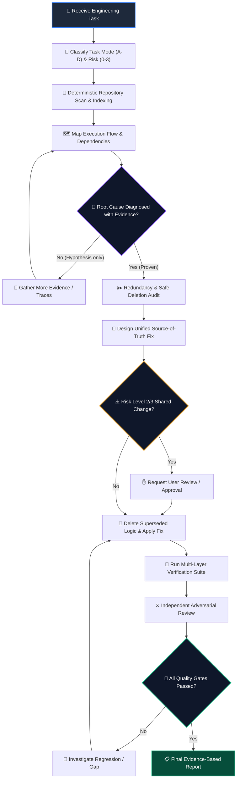

<div align="center">

# 🏛️ Root-Cause Architect `v2.0`
### *Evidence-Driven AI Software Engineering & Architectural Intelligence System*

[](./VERSION)
[](https://python.org)
[](#quick-start-zero-external-dependencies)
[](#verification--test-suite)
[](./LICENSE)

<br/>

**Transform coding agents from hasty autocomplete bots into disciplined senior software architects.**  
Diagnose the earliest invalid state • Challenge existing architecture • Prune redundant code • Implement unified fixes • Prove runtime correctness.

<br/>

[Core Workflow](#-the-evidence-driven-workflow) •
[Operating Modes](#-four-operating-modes) •
[Specialist Agents](#-the-14-specialist-roles) •
[CLI Quickstart](#-analysis-toolkit-cli) •
[Cross-Platform Setup](#-cross-platform-adapters)

</div>

---

## 💡 Why Root-Cause Architect?

Most AI coding assistants act like autocomplete: they spot an error message and write a superficial patch (e.g., adding `if x is None: return` downstream) instead of fixing the root cause. This leads to **architectural drift**, **duplicated logic**, and **hidden technical debt**.

**Root-Cause Architect enforces senior engineering discipline:**
- 🚫 **No Band-Aid Fixes:** Never mask symptoms or suppress exceptions without understanding their origin.
- 🔍 **Evidence-First:** Every diagnosis must be labeled `PROVEN`, `STRONGLY SUPPORTED`, or `HYPOTHESIS`. Hypotheses are never treated as proven facts.
- ✂️ **Delete-First Implementation:** Remove superseded workarounds and consolidate duplicate business rules before adding new code.
- 🛡️ **Blast-Radius Awareness:** Trace upstream callers, downstream dependencies, and dynamic registration sites (`getattr`, decorators, routes) before touching code.
- 🧪 **Multi-Layered Verification:** Static checks, unit tests, contract validation, and adversarial reviews. Passing a unit test does not automatically prove system correctness.

---

## ⚡ The Evidence-Driven Workflow



---

## 🎛️ Four Operating Modes

Choose the least expensive mode that establishes the truth. Never flood context or invoke all specialists for a localized fix.

| Mode | Target Scope | Typical Workflow |
| :--- | :--- | :--- |
| **Mode A — Quick Bug Fix** | Localized, 1–2 module bugs (Risk Level 1) | `Scope` ➔ `Trace` ➔ `Diagnose` ➔ `Fix Source` ➔ `Test` ➔ `Review` |
| **Mode B — Deep Engineering** | Multi-module, async, API/DB defects (Risk Level 2–3) | `Map` ➔ `Trace Flow` ➔ `Git History` ➔ `Prune Debt` ➔ `Rewrite` ➔ `Regression Suite` |
| **Mode C — Architecture Discovery** | Large, complex, or unfamiliar codebases | `Scan` ➔ `Knowledge Graph` ➔ `Map Contracts` ➔ `Boundary Check` ➔ `Doc System` |
| **Mode D — Architectural Refactoring** | High-risk shared abstractions, structural changes | `Map Blast Radius` ➔ `Migration Plan` ➔ `Approval Gate` ➔ `Prune` ➔ `Rewrite` ➔ `Adversarial Gate` |

---

## 👥 The 14 Specialist Roles

Operate as independent subagents on supported platforms (Antigravity, Claude Code) or as sequential reasoning stages:

<details>
<summary><b>Click to expand the 14 specialist roles & responsibilities</b></summary>
<br/>

| Role | Responsibility | Companion Spec |
| :--- | :--- | :--- |
| **1. Orchestrator** | Coordinates workflows, selects mode (A–D), and enforces safety levels (0–3). | [`agents/orchestrator.md`](./agents/orchestrator.md) |
| **2. Repository Analyst** | Discovers languages, manifests, frameworks, entrypoints, and sensitive files. | [`agents/repository-analyst.md`](./agents/repository-analyst.md) |
| **3. Architecture Analyst** | Maps boundaries, contracts, storage layers, and system invariants. | [`agents/architecture-analyst.md`](./agents/architecture-analyst.md) |
| **4. Dependency Analyst** | Maps callers, callees, imports, routes, and blast-radius coverage. | [`agents/dependency-analyst.md`](./agents/dependency-analyst.md) |
| **5. Data Flow Analyst** | Traces inputs, schema validations, transformations, outputs, and side-effects. | [`agents/data-flow-analyst.md`](./agents/data-flow-analyst.md) |
| **6. Root-Cause Investigator** | Isolates the earliest invalid state and underlying defect from visible symptoms. | [`agents/root-cause-investigator.md`](./agents/root-cause-investigator.md) |
| **7. Duplication Analyst** | Detects duplicate rules, obsolete workarounds, and dead branches. | [`agents/duplication-analyst.md`](./agents/duplication-analyst.md) |
| **8. Refactoring Architect** | Designs one authoritative source-of-truth solution and rollback plan. | [`agents/refactoring-architect.md`](./agents/refactoring-architect.md) |
| **9. Implementation Engineer**| Executes approved delete-first code changes with minimal diff footprint. | [`agents/implementation-engineer.md`](./agents/implementation-engineer.md) |
| **10. Test Engineer** | Executes static, unit, contract, integration, and regression checks with proof. | [`agents/test-engineer.md`](./agents/test-engineer.md) |
| **11. Security Reviewer** | Audits auth, permissions, input boundaries, secrets, and injection vectors. | [`agents/security-reviewer.md`](./agents/security-reviewer.md) |
| **12. Performance Reviewer** | Assesses runtime complexity, N+1 queries, memory footprint, and I/O costs. | [`agents/performance-reviewer.md`](./agents/performance-reviewer.md) |
| **13. Regression Reviewer** | Confirms preserved contracts and existing caller behavior across blast radius. | [`agents/regression-reviewer.md`](./agents/regression-reviewer.md) |
| **14. Adversarial Reviewer** | Independently challenges diagnosis, patches, deletions, and verification proof. | [`agents/adversarial-reviewer.md`](./agents/adversarial-reviewer.md) |

</details>

---

## 🛠️ Analysis Toolkit (CLI)

The Python analysis toolkit is **deterministic and local-first**. It works with **zero external dependencies** on Python 3.11+ standard library.

```bash
cd root-cause-architect

# 1. Health check & configuration validation
python3 scripts/analyze.py health
```

```bash
# 2. Map repository structure, frameworks, and entrypoints (User-facing Markdown or JSON)
python3 scripts/analyze.py map /path/to/repo --output repository-map.md
```

```bash
# 3. Build & validate the dependency graph (Exports JSON, Mermaid flowchart, and interactive 3D WebGL file/function/pipeline map)
python3 scripts/analyze.py graph /path/to/repo --output dependency-graph.json --mermaid architecture.mmd --html architecture-3d.html
```

```bash
# 4. Blast-radius impact analysis for a file or symbol
python3 scripts/analyze.py impact /path/to/repo app/services/payment.py --depth 3
```

<details>
<summary><b>Example: Blast-Radius Output in Markdown</b></summary>

```markdown
# Blast-Radius Impact — `app/services/payment.py`

- **Matched nodes:** 1
- **Upstream dependents:** 4
- **Downstream dependencies:** 2
- **Covering tests:** 1
- **Dynamic registration warnings:** 2

## Upstream Dependents (Affected if Target Changes)
- [depth 1] `file:app/main.py` (file)
- [depth 1] `app/main.py::create_payment` (function)
- [depth 2] `route:POST /api/payments` (route)

## Covering Tests
- `tests/test_payment.py`

## Dynamic Registration / Reflection Warnings
- `app/services/payment.py:22` (decorator_registration): @register on on_payment_webhook
- `app/services/payment.py:23` (reflection): getattr(...) in on_payment_webhook
```
</details>

---

## 🔌 Cross-Platform Adapters

One canonical skill package adapts cleanly to all major coding environments:

| Platform | Integration Path | Documentation |
| :--- | :--- | :--- |
| **Google Antigravity** | `.agents/skills/root-cause-architect/SKILL.md` | [Antigravity Guide](./adapters/antigravity/settings-guide.md) |
| **Claude Code** | `.claude/skills/root-cause-architect/SKILL.md` | [Claude Code Guide](./adapters/claude-code/settings-guide.md) |
| **Cursor** | `.cursor/skills/` + `.cursor/rules/root-cause-architect.mdc` | [Cursor Guide](./adapters/cursor/settings-guide.md) |
| **OpenAI Codex** | `AGENTS.md` at repository root | [Codex Config](./adapters/codex/AGENTS.md) |
| **Windsurf / Cline / Roo** | Workspace rules pointing to canonical `SKILL.md` | [Universal Config](./adapters/universal/AGENTS.md) |

---

## 📂 Project Architecture

```arduino
root-cause-architect/
│
├── SKILL.md                  # Canonical Agent Skill (Philosophy, Modes, Anti-Patch Rules, Safety)
├── VERSION                   # 2.0.0
│
├── adapters/                 # Platform-specific discovery files & settings guides
│   ├── antigravity/          # rules.md & settings-guide.md
│   ├── claude-code/          # CLAUDE.md & settings-guide.md
│   ├── cursor/               # root-cause-architect.mdc & settings-guide.md
│   ├── codex/                # AGENTS.md
│   ├── windsurf/             # rules.md
│   ├── cline/                # rules.md
│   └── universal/            # AGENTS.md
│
├── agents/                   # 14 specialist agent role specifications
├── workflows/                # 15 scenario-specific engineering workflows
├── config/                   # 7 configuration definitions (languages, frameworks, safety, etc.)
├── engine/                   # Deterministic Python analysis toolkit (Phases 1–3 implemented)
│   ├── repository/           # Scanner, file classifier, framework/entrypoint detectors
│   ├── parsers/              # Native Python AST, JS/TS structural, fallback parser
│   └── graph/                # Symbol index, import graph, call graph, dependency knowledge graph
│
├── scripts/                  # Unified CLI tooling (analyze.py, map_project.py, generate_graph.py, etc.)
├── schemas/                  # 9 JSON schemas for deliverables (repository, flow, diagnosis, etc.)
├── templates/                # 9 standard reporting & planning templates
├── references/               # 17 deep architectural & engineering reference guides
├── tests/                    # Unit, parser, graph, and CLI dogfood integration tests
└── docs/                     # Comprehensive architecture, commands, and security guides
```

---

## 🚦 Safety & Quality Gates

Root-Cause Architect operates under strict risk tiers configured in [`config/safety.yaml`](./config/safety.yaml):

```text
Level 0: Read-Only      ───► Automated (Repo scan, graphing, blast-radius check)
Level 1: Local Fix      ───► Automated (Scoped bug fix, unused import removal, unit tests)
Level 2: Shared Change  ───► Review Required (Shared business logic, public contracts)
Level 3: Critical       ───► Explicit Approval (Migrations, auth, payments, destructive ops)
```

**Non-negotiable safety guardrails:**
- 🔒 Secrets and `.env` files are classified `inventory_only` and **never read or printed**.
- 🚫 Destructive database migrations and silent migration history rewrites are strictly blocked.
- 💾 Uncommitted user changes in git are always preserved.

---

## 🧪 Verification & Test Suite

Verify the toolkit and run all unit and integration tests:

```bash
python3 -m unittest tests/unit/test_file_classifier.py \
                     tests/unit/test_detectors.py \
                     tests/parsers/test_parsers.py \
                     tests/graph/test_graph.py \
                     tests/integration/test_cli.py -v
```

```text
Ran 23 tests in 0.51s
OK (23/23 tests passing)
```

---

<div align="center">

Built with senior engineering discipline for the next generation of autonomous AI developers.  
**Understand the system • Fix the cause • Prove the result.**

</div>